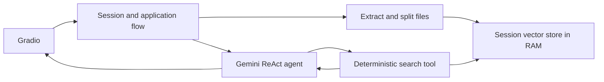

# NewPage

Chat with Gemini and attach PDFs or text files whenever you need document context.
The agent chooses when and where to search and shows the supporting passages.

## Run locally

Requires Docker and a [Gemini API key](https://aistudio.google.com/api-keys).

```bash
cp .env.example .env
# Set GOOGLE_API_KEY in .env. Never commit this file.
docker build --pull -t newpage:local .
docker run --rm --env-file .env -p 127.0.0.1:7860:7860 newpage:local
```

Open **http://localhost:7860** and start chatting. Use the paperclip in the message
box to attach PDF/TXT files, with or without a question. Files are indexed when
you send the message. Expand **Sources** to inspect the latest retrieved evidence.
**New chat** clears the conversation, its documents, and its agent memory.
Gemini receives extracted text and questions; indexing and chat incur API usage.

## Design



The UI uses Gradio's native `Chatbot` and `MultimodalTextbox` and calls
functions in `core/engine.py`. `documents.py` owns ingestion and
retrieval; `agent.py` owns prompts, model configuration, and the tool loop.
No separate backend service, authentication, or database is required.

Each browser session owns its documents, `InMemoryVectorStore`, and agent
checkpoints (`InMemorySaver`). Refreshing starts a new session; restarting the
application clears everything. Temporary uploads and session state expire.

## Check the prototype

```bash
docker build --pull --target development -t newpage:dev .
docker run --rm --network none newpage:dev
docker run --rm --network none newpage:dev ruff check .
docker run --rm --network none newpage:dev ruff format --check .
```

Tests use synthetic documents and local model/embedding doubles. They exercise
the real LangChain tool loop without paid calls or telemetry. Live Gemini answer
quality still requires manual evaluation with an API key.

## Choices and limits

- Gemini `gemini-3.8-flash` for answers; `gemini-embedding-001` for text search.
  Both are configurable in `.env`.
- Character chunks of 1,200 with 180 overlap; top four passages per search.
- Up to 10 files, 10 MB each, 200 PDF pages, 150,000 characters per file,
  and 500 chunks per session. No OCR or image/table interpretation.
- Up to three searches per turn and 20 turns per conversation. Operations are
  queued one at a time. Failed model runs reset conversation memory, keeping files.
- Logs contain operational metadata. LangSmith is optional and off by default;
  inputs/outputs are hidden by default. Configure your own tracing destination.
- Dependencies are constrained in `requirements.lock`; the Python 3.14 Debian
  base is pinned by digest. Update them deliberately and rerun checks.

## Next steps

Before public GCP hosting: add authentication and backend access checks, store
originals in Cloud Storage, and select durable conversation and vector storage.
Cloud Run is a candidate, but RAM state cannot support multiple instances as-is.
Add rate limits, retention policies, quality evaluation, deployment automation,
and a fresh image audit before publishing.

The initial image scan still reports high-severity Debian findings without fixes;
this prototype is not approved for public deployment. See development notes.

See [development notes](docs/development.md) for decisions, AI assistance,
verification, and deferred work. [Interface screenshot](docs/screenshot.png).
