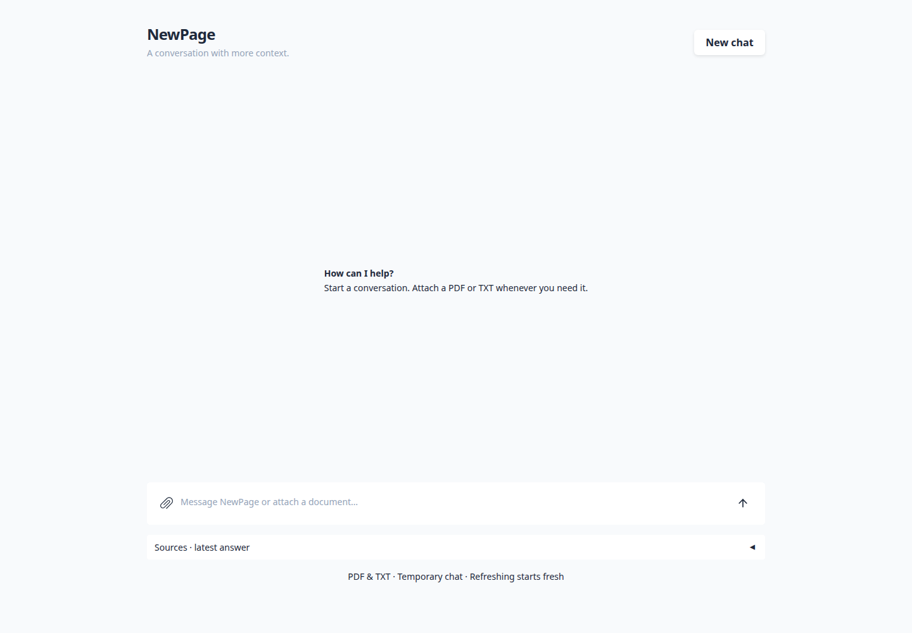
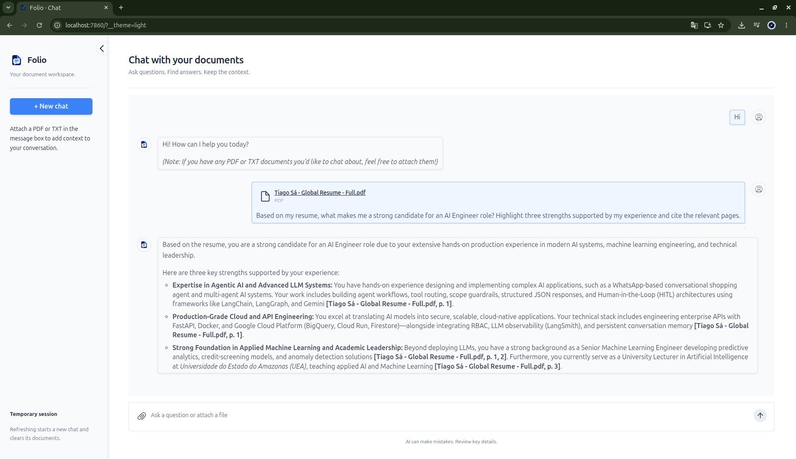
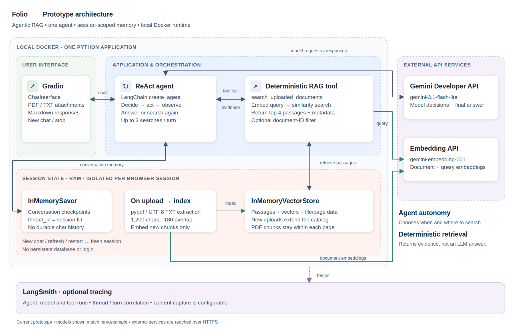

# Folio

I built Folio as a local document chat with Gradio, LangChain, and Gemini.
A single ReAct-style agent decides when to search uploaded PDFs and text files.



An example answer with document and page references:



## Run locally

Requires Docker and a [Gemini API key](https://aistudio.google.com/api-keys).
From the repository root:

```bash
cp .env.example .env
# Set GOOGLE_API_KEY in .env.
docker build --pull -t folio:local .
docker run --rm --env-file .env -p 127.0.0.1:7860:7860 folio:local
```

Open **http://localhost:7860**. Chat normally or attach files with the paperclip.
Files are indexed when sent; new uploads preserve earlier documents.
**New chat** clears the session. Refreshing or restarting also loses its state.

Keep `.env` outside Git. API calls use your provider quota and may incur charges.

## Architecture and decisions



[Editable SVG](docs/architecture.svg)

- **Agentic RAG / ReAct:** I chose one LangChain agent to select searches and
  documents, with a deterministic tool retrieving passages. I first considered
  passing all document text directly to the model.
- **Models:** I chose Gemini `gemini-3.1-flash-lite` and `gemini-embedding-001`
  to keep one provider setup. Both are configurable in `.env`; I have not
  benchmarked alternatives.
- **Retrieval:** I started with pypdf, 1,200-character chunks, 180 overlap, and
  four passages per search. PDF chunks stay within pages. These values need evaluation.
- **Memory:** I used `InMemorySaver` and `InMemoryVectorStore` to avoid database
  setup for this prototype. History, passages, and embeddings stay in RAM.
- **Answers:** I kept the prompt short, covering Markdown, evidence, uncertainty,
  and file/page citations. History and retrieved passages provide context;
  backend citation validation is still pending.

Start with [app.py](app.py) for the UI and [core/engine.py](core/engine.py) for session
flow. [core/documents.py](core/documents.py) handles documents and retrieval;
[core/agent.py](core/agent.py) defines the prompt, models, and tool.

## Checks and limits

```bash
docker build --pull --target development -t folio:dev .
docker run --rm --network none folio:dev
docker run --rm --network none folio:dev ruff check .
docker run --rm --network none folio:dev ruff format --check .
```

I used synthetic files and model doubles for tests. A repeatable evaluation of live
answer quality is still pending. Logs record errors, timing, and correlation IDs. LangSmith
is optional: configure its key and agent ID, then enable `LANGSMITH_TRACING`.
The example allows capturing messages and document content when tracing is enabled.

Limits: 10 files, 10 MB each, 200 PDF pages, 500 chunks per session, and 20 turns.
Each turn allows three searches; model requests allow three total attempts.
Failed runs reset agent memory but keep indexed documents. No OCR, login, or
rigorous guardrails.

## Development with AI

I started by creating [AGENTS.md](AGENTS.md) to guide AI-assisted development:
discuss decisions before coding, work in small increments, and check changes.
I defined the scope and approved changes; Codex helped with implementation and
debugging. I refined the application based on feedback from using it.

I prioritized explicit functions, separate UI/core responsibilities, offline tests,
Ruff, locked dependencies, and a non-root container. I recorded the main decisions
and trade-offs in [development notes](docs/development.md).

## With more time: quality and a GCP deployment

I would focus on:

- **Deeper evaluation:** combine [LLM-as-judge](https://docs.langchain.com/langsmith/evaluation-types#llm-as-a-judge)
  with human-reviewed examples. Test correctness, grounding, and relevance across
  languages, personas, informal wording, ambiguous questions, and multi-turn chats.
- **Citation validation:** add deterministic backend checks for document ownership,
  file/page references, and quoted passages against the retrieved source. I would
  not treat an LLM-generated citation as proof: checking that a source exists is
  separate from evaluating whether it actually supports the claim.
- **Document support:** add `.doc`/`.docx`, `.xlsx`, and `.csv`, preserving structure
  where useful. PDFs currently provide text only; add OCR and multimodal processing
  for scanned pages, embedded images, charts, and tables.
- **Retrieval:** evaluate chunk sizes, overlap, hybrid search, and reranking against
  a baseline. Measure retrieval quality, latency, and cost before adding complexity.
- **Context management:** add conversation-level token and cost budgets, history
  compaction, and a retrieval context budget while preserving source references.
- **Sessions and security:** build on the existing per-session isolation with login,
  server-managed sessions, expiry, and document ownership checks. Evaluate FastAPI
  middleware and secure cookies, plus guardrails for malicious inputs and document
  instructions. An input filter or security agent would complement backend controls.
- **Persistence:** store originals in Cloud Storage and consider Firestore for
  conversation history. Select durable checkpoints and vector storage, such as
  Vertex AI Vector Search, with access filtering and retention/deletion policies.
- **Production:** prepare Cloud Run for shared state and concurrent sessions. Add
  Secret Manager, correlated Cloud Logging, quality/error/latency monitoring,
  rate limits, and CI/deployment automation with rollback.

The initial image audit found unresolved high-severity Debian findings. A public
release needs a fresh audit and treatment of applicable findings.
