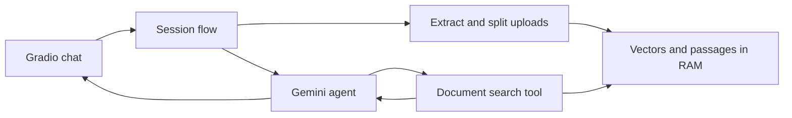

# Folio

A local **agentic RAG** prototype for chatting with PDF and TXT documents.
Built with Gradio and LangChain, it uses one Gemini agent to choose when and
which documents to search.


## Run locally

Requires Docker and a [Gemini API key](https://aistudio.google.com/api-keys).
Run from the repository root:

```bash
cp .env.example .env
# Edit .env: set GOOGLE_API_KEY.
# Set GEMINI_MODEL=gemini-3.1-flash-lite to use the model tried in manual sessions.
docker build --pull -t folio:local .
docker run --rm --env-file .env -p 127.0.0.1:7860:7860 folio:local
```

Open **http://localhost:7860**. Start chatting or choose a suggestion, attach files
with the paperclip, and send. New uploads extend the index. Files-only messages
index documents without calling the chat model. **New chat** clears the session.

Never commit `.env`. Model calls and embeddings use your API quota and may incur
charges. Model settings are configurable; `.env.example` currently defaults to
`gemini-3.8-flash`, so set the override above for the model used during development.

## How it works



The agent can search again or select particular files. The tool returns passages
and metadata; Gemini writes the answer.
`InMemoryVectorStore` holds passages and embeddings, while `InMemorySaver` holds
agent checkpoints. **Refreshing or restarting loses the session.** There is no
durable application history or vector database.

To read the code, start with [app.py](app.py) for the UI, then
[core/engine.py](core/engine.py) for session operations.
[core/documents.py](core/documents.py) handles extraction, chunking, and retrieval;
[core/agent.py](core/agent.py) contains the prompt, clients, and agent tool.

## Choices and trade-offs

| Choice | Why we used it |
|---|---|
| Gemini chat and `gemini-embedding-001` | One provider setup. Manual sessions used Flash Lite to start with a lower-cost model; alternatives were not benchmarked. |
| LangChain agent with one search tool | Lets the model choose searches while keeping the tool surface small. Passing all extracted text directly was considered first. |
| Recursive character splitting | A simple starting point: 1,200 characters, 180 overlap, and up to four passages per search. These values need quality evaluation. |
| In-memory state | Avoids database setup for a local prototype; persistence and multi-instance operation are deferred. |
| One Python application with functions | Keeps UI and core logically separate without extra services or abstraction layers. |

PDF extraction uses pypdf and keeps page metadata. Chunks stay within each page.
The short ROLE/GOAL/INSTRUCTIONS/STYLE prompt asks for Markdown answers, retrieved
evidence, readable file/page citations, and acknowledgment of missing or conflicting
information. Citations are requested through the prompt, not independently validated.
Search results and conversation history share the model context; old messages are
not summarized automatically.

## Checks, observability, and limits

```bash
docker build --pull --target development -t folio:dev .
docker run --rm --network none folio:dev
docker run --rm --network none folio:dev ruff check .
docker run --rm --network none folio:dev ruff format --check .
```

Offline tests exercise the actual agent/tool loop, isolation, uploads, limits, and
failures with synthetic files and model doubles. Manual Gemini use is not a
repeatable answer-quality evaluation.

Logs contain correlation IDs, errors, and durations. LangSmith tracing is optional
and off by default; set its destination and key before enabling it. Inputs/outputs
are hidden by default. Capturing them can send document and conversation content
to LangSmith.

The prototype has basic file validation and execution bounds, not rigorous guardrails:

- Up to 10 documents, 10 MB each, 200 PDF pages, and 150,000 characters per file;
  at most 500 chunks per session. No OCR or image/table interpretation.
- Up to three searches per turn, 20 turns per conversation, and three total SDK
  attempts per chat-model request. Retries can increase waiting time.
- Failed agent runs reset model conversation memory but preserve indexed documents.
- No login, abuse prevention, or production access-control layer. Prompt instructions
  about untrusted documents are not a complete prompt-injection defense.

## How AI assisted development

We started with [AGENTS.md](AGENTS.md): discuss decisions before coding, work in
small increments, preserve existing work, and run relevant checks. The developer
chose scope and approved changes; Codex assisted implementation and debugging.
Using the application guided refinements.

Standards include explicit functions, separated responsibilities, external secrets,
offline tests, Ruff, a runtime dependency lock, and a non-root Docker image.
CI, formal quality benchmarks, and comprehensive security controls are deferred.
The [development notes](docs/development.md) explain the decisions in more detail.

## With more time: quality and a GCP deployment

These are next steps, not implemented services:

1. **Quality:** evaluate factual questions, summaries, conflicting files, and missing
   evidence before tuning retrieval. Consider reranking, OCR, structured answers,
   and backend citation validation.
2. **Identity and guardrails:** add login and backend ownership checks. Define abuse
   cases and evaluate input screening with rules or a security-focused agent.
   An extra agent adds latency and cost; backend access controls remain necessary.
3. **Persistence:** consider Cloud Storage for original files and
   [Firestore](https://docs.cloud.google.com/firestore/native/docs/langchain) for
   conversation history and metadata. Select durable agent checkpoints and vector
   storage; [Vertex AI Vector Search](https://cloud.google.com/vertex-ai/docs/vector-search/overview)
   is one candidate, subject to volume, cost, and access-filter requirements.
4. **Operations and scaling:** consider Cloud Run once state is externalized. Review
   concurrency and upload processing for multiple instances; add Secret Manager,
   Cloud Logging correlation, monitoring, retention/deletion rules, rate and cost
   limits, and a deployment pipeline with rollback.

An initial image audit found unresolved high-severity Debian findings. That result
is historical; a production release needs a fresh audit and treatment of applicable
findings before public exposure.
